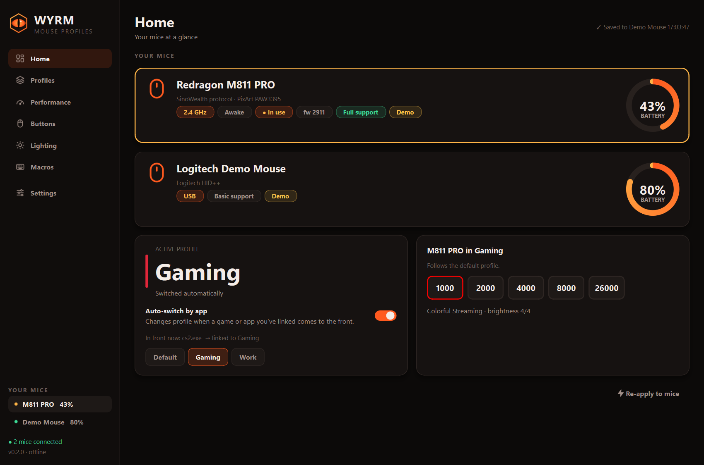
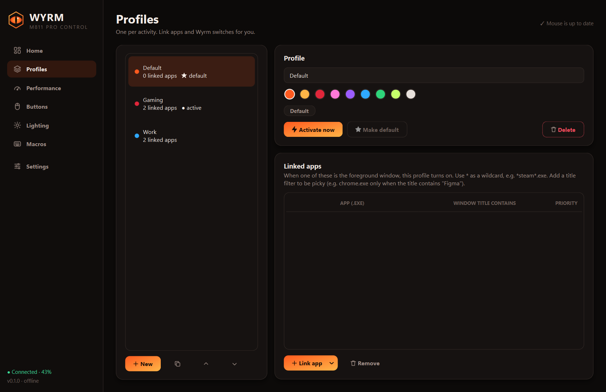
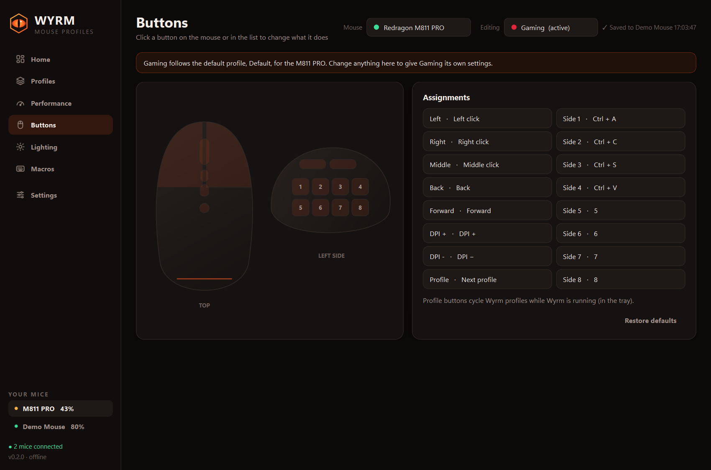
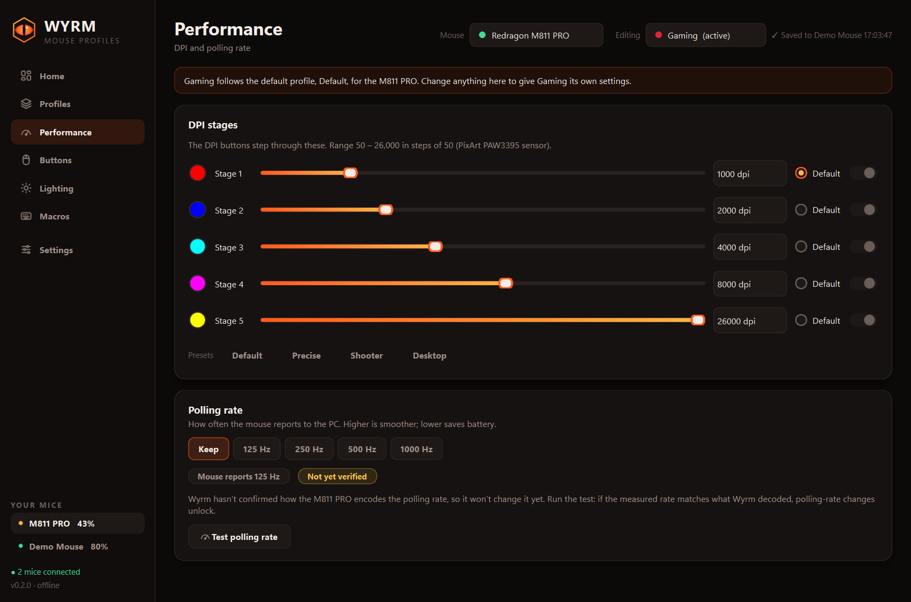
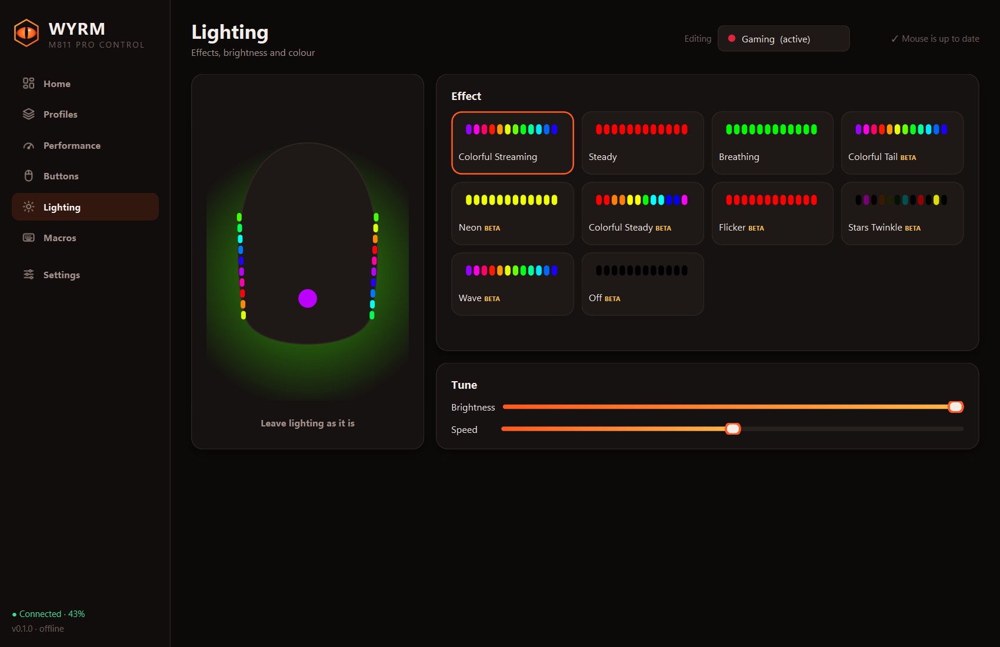

<p align="center">
  
</p>

# Wyrm

🥚 Just want it working? [Wyrm.exe ↓](https://github.com/Maxwegy/wyrm/releases/latest/download/Wyrm.exe). Save it, run it, done. (Windows may say “unrecognized app”: click More info → Run anyway.)

**An open-source, offline replacement for the Redragon M811 PRO mouse software.**

The stock app for the M811 PRO is a generic OEM tool. It hides profile switching, offers only import and export
on its home screen, and looks like 2009. Wyrm talks to the mouse directly over USB HID. It adds what was
missing: named profiles for each activity, automatic switching when a game or app comes to the front, and a
Profile button on the mouse that actually cycles them.

> Not affiliated with or endorsed by Redragon. "Redragon" and "M811" are used only to say which mouse this works with.

## Features

- **Profiles per activity**, such as Gaming, Work and Editing, each with its own DPI, buttons, lighting and macros.
- **Auto-switch by app.** Link `cs2.exe`, `*valorant*.exe` or `chrome.exe` (only when the title contains "Figma")
  and Wyrm switches the moment that window is in front. Priorities break ties, and a default profile covers
  everything else.
- **Switch from the mouse.** The Profile button on top cycles Wyrm profiles, and a toast shows which one
  you're on. You can also put "next/previous profile" on any button.
- **DPI:** 5 stages from 50 to 26,000 in steps of 50, with presets, per-stage indicator colours and the default
  stage.
- **Buttons:** all 16 buttons can be mouse clicks, key combos, media keys, DPI controls, rapid fire, macros or
  profile switching. You pick them from a clickable diagram of the mouse.
- **Lighting:** effects with a live animated preview, plus brightness, speed and colours.
- **Macros:** record keys and clicks with real timing, or edit the steps by hand. Macros are stored on the
  mouse and work everywhere.
- **Tray app:** battery %, sleep/awake state, quick profile menu, and start with Windows.
- **Polling-rate tester** that measures the real report rate with Windows Raw Input.
- **Offline by design.** Wyrm makes no network calls: no telemetry, no update checks, no account.

| | |
|---|---|
|  |  |
|  |  |

## Install

**Download:** grab `Wyrm.exe` from [Releases](../../releases) and run it. It's a single file, so put it
anywhere. `Wyrm-windows.zip` is the same app unpacked into a folder, which starts a little faster.

**Build it yourself:** `powershell -File packaging\build.ps1` puts a fresh `Wyrm.exe` in the project folder.

**From source** (Python 3.10+):

```bash
git clone https://github.com/Maxwegy/wyrm.git
cd wyrm
python -m pip install -e .
python -m wyrm
```

`python -m wyrm --demo` runs the whole app against a simulated mouse, which is handy for poking around or
developing without the hardware.

You don't need to uninstall the Redragon app, but don't run both at the same time. Each one rewrites the mouse
when it switches profiles.

## First run

1. Wyrm finds the receiver (or the USB-C cable) and saves a **snapshot of your mouse's current settings**.
   **Settings → Restore original settings** writes it back.
2. Your current mouse setup becomes the **Default** profile.
3. Before the first write, Wyrm asks permission. The only change at that point is that the **Profile button now
   cycles Wyrm profiles** (it sends F24, which Wyrm listens for).
4. Create profiles on the **Profiles** page and link apps to them. Turn on **Start with Windows** in Settings
   so auto-switch works all the time.

## How safe is it?

Wyrm writes to the mouse's settings memory the same way the vendor app does, but more defensively:

- **Check before write.** It reads the current block first, changes only the bytes it understands, and leaves
  everything else exactly as it was.
- **Refuses unknown hardware.** It won't write if the block doesn't carry the M811 PRO's model marker.
- **Waits for the mouse.** Changes made while the mouse sleeps are queued until it wakes.
- **Verifies every write.** It reads the block back after every write and tells you if it didn't stick.
- **Skips no-op writes.** If the mouse already matches, it writes nothing.
- **Never touches firmware.** The firmware-update / bootloader command is on a hard block-list.
- **Dry run.** Settings has a mode that logs what Wyrm would write without sending it.

### What's verified

Verified on real hardware (firmware 2911, receiver), including write and read-back:

- DPI stages, stage colours and the default stage
- button blocks: mouse buttons, keys and combos, DPI ±, the Profile button
- macro storage: written to the mouse, read back and cleared
- battery and sleep detection

Implemented and encoded per the SinoWealth protocol, but nobody has pressed the button to confirm yet:

- macro playback from a button
- media keys, rapid fire, sniper DPI, lighting on/off

These need a confirmation from someone with the mouse, so they're **off unless you enable "Experimental writes"**:

- polling-rate changes (use **Performance → Test polling rate**, which unlocks it automatically when the
  measurement matches)
- lighting effects other than Colorful Streaming, Steady and Breathing
- disabling individual DPI stages

The full byte-level notes are in [docs/protocol-m811pro.md](docs/protocol-m811pro.md). Dumps and diffs for the
open questions are very welcome.

## About the stock software

Before building Wyrm, the original installation (`OemDrv.exe`) was audited. It imports no networking libraries
(no WinINet, WinHTTP, Winsock or URLMon), so it cannot auto-update or phone home. It doesn't autostart, and its
firmware-update screen is disabled in its config. It's a skinned copy of a generic SinoWealth OEM tool, which
is why it feels the way it does.

## Development

```bash
python -m pip install -e ".[dev]"
python -m pytest                       # codec, rules, storage, device worker against a simulated mouse
python tools/screenshot.py             # render every page to captures/screens/
powershell -File packaging/build.ps1   # build Wyrm.exe into the project folder
```

Layout:

- `wyrm/hid`: device discovery, size-checked transport, protocol, byte codecs, a simulated mouse.
- `wyrm/hid/layouts/m811pro.json`: the settings-block byte map as data, so adding a sibling mouse is mostly a
  new JSON file.
- `wyrm/core`: profiles, auto-switch rules, the device worker thread, Windows helpers.
- `wyrm/ui`: the PySide6 app.
- `tools`: discovery and debugging scripts (`probe_paths.py`, `dump_blocks.py`, `write_selftest.py`).

Other SinoWealth mice with the same `258a:002e/002f` IDs (for example the Redragon M690 PRO) speak a close
dialect. Pull requests that add their layouts are welcome.

## Credits

Protocol knowledge builds on [libratbag's SinoWealth driver](https://github.com/libratbag/libratbag) (MIT) and
the [OpenMouse M690 PRO notes](https://github.com/OpenMouse-Project/mouse-protocol). Wyrm uses no code from
either project.

## License

[MIT](LICENSE)
